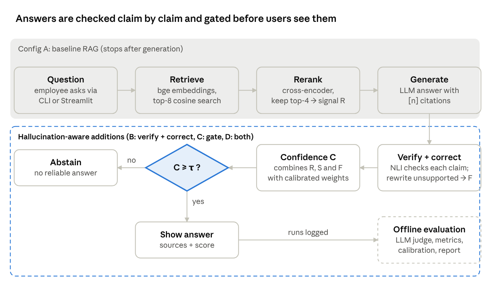

# Hallucination-Aware RAG Knowledge Base — Project Documentation

A working Python prototype of an enterprise knowledge assistant. It checks its own answers against the source documents, scores its confidence, and abstains instead of guessing. It also includes an evaluation harness that compares it with baseline RAG.

## Overview

The prototype answers employee questions from company documents. It reduces hallucinated answers by checking every claim against the retrieved sources before the answer is shown.

**Problem.** Retrieval-augmented generation (RAG) grounds an LLM in company documents, but the model can still add details the documents do not contain, such as a wrong amount, deadline or approval rule. In enterprise knowledge management these errors are costly because employees act on them.

**Approach.** On top of a standard RAG pipeline, the system adds three mechanisms:

1. **Context-grounded verification:** the answer is split into atomic claims, and each claim is checked against the retrieved passages by an NLI model or an LLM judge.
2. **Correction:** unsupported claims are removed or rewritten before the answer is shown.
3. **Confidence gating:** a score built from retrieval relevance, semantic similarity and faithfulness decides whether to answer or abstain.

**Deliverables.**

- the Python package `harag`
- a command-line interface
- a Streamlit demo app
- a sample enterprise corpus with 86 evaluation questions
- an automated evaluation and reporting pipeline
- unit tests

## Mapping to thesis subtasks

The prototype covers the practical subtasks 4–8 of the thesis data sheet and produces the evidence for subtask 9.

| Subtask | Where it is implemented |
| --- | --- |
| 4. Prototype with semantic retrieval and answer generation | `documents.py`, `embeddings.py`, `vectorstore.py`, `reranker.py`, `pipeline.py` |
| 5. Context-grounded verification and LLM-as-a-judge | `verifier.py` (runtime), `evaluation/judge.py` (offline judge) |
| 6. Confidence scoring (retrieval relevance, semantic similarity, RAGAS metrics) | `confidence.py`, `evaluation/calibration.py`, `evaluation/ragas_eval.py` |
| 7. Baseline vs hallucination-aware comparison | Configurations A–D in `pipeline.py`, `evaluation/runner.py` |
| 8. Evaluation: faithfulness, answer relevance, hallucination reduction | `evaluation/metrics.py`, `evaluation/report.py`, `evaluation/annotation.py` |
| 9. Analysis and recommendations | Input: `results/test/report.md`, figures and per-question results |

## Architecture



The grey band is the baseline RAG pipeline (configuration A). The dashed band adds claim verification with correction, and the confidence gate. Offline evaluation reads the logged runs and also fits the weights and threshold that the gate uses.

## Components

Each stage is a separate module with one interface, so models can be swapped through `config.yaml` without code changes.

| Module | Responsibility | Default model / method |
| --- | --- | --- |
| `documents.py` | Loads .md, .txt, .pdf and .docx files; chunks them by section (180 words, 30 overlap), keeping the title and section for citations | — |
| `embeddings.py` | Dense embeddings, L2-normalised so that dot product = cosine similarity | BAAI/bge-small-en-v1.5 (bge-m3 for Hungarian) |
| `vectorstore.py` | Persistent exact cosine search over chunk vectors | NumPy |
| `reranker.py` | Scores (question, passage) pairs from 0 to 1; this score is also signal R | BAAI/bge-reranker-base |
| `llm.py` | OpenAI-compatible chat client with an SQLite response cache, retries, and token and latency tracking | Ollama llama3.1:8b (generator), qwen2.5:14b (judge) |
| `prompts.py` | All prompts: generation with citations, claim extraction, verification, correction, judge | — |
| `verifier.py` | Splits answers into atomic claims and verifies them with NLI, LLM-as-a-judge or lexical matching | cross-encoder/nli-deberta-v3-base |
| `confidence.py` | Computes signals R, S, F and the combined score C; makes the answer / flag / abstain decision | Weighted or logistic |
| `pipeline.py` | `RAGSystem`, configurations A–D, per-stage timing and cost accounting | — |
| `evaluation/` | Judge, runner, metrics, statistics, calibration, report, human annotation, RAGAS adapter | — |
| `cli.py`, `app.py` | Command-line interface and Streamlit demo UI | — |

The generator and judge can use any OpenAI-compatible endpoint: Ollama, OpenAI, Azure OpenAI, vLLM, LM Studio or Groq.

## Experimental configurations

All four configurations share the same retriever, prompt, models and questions. Any difference in results therefore comes from the hallucination-aware components alone.

| Config | Retrieval, rerank, generation | Claim verification + correction | Confidence gate | Purpose |
| --- | --- | --- | --- | --- |
| A. Baseline RAG | Yes | No | No | Reference point |
| B. + Verification & correction | Yes | Yes | No | Effect of verification alone |
| C. + Confidence gate | Yes | Verification feeds the score only | Yes | Effect of abstention alone |
| D. Hallucination-aware RAG | Yes | Yes | Yes | Full system |

For A and B the confidence signals are still computed in "shadow" mode. This work is excluded from latency and cost. It lets the evaluation measure how well the score predicts hallucinations in every configuration.

## Confidence scoring and calibration

The confidence score C combines three signals, each between 0 and 1. The weights and the abstain threshold τ are fitted on a separate calibration split.

- **R (retrieval relevance):** mean reranker score of the top 3 passages. A low R means the knowledge base probably does not cover the question.
- **S (semantic similarity):** for each answer sentence, the best cosine similarity to any retrieved passage, averaged over the sentences.
- **F (faithfulness):** share of the answer's claims that the verifier marks as supported.

```
C_weighted = w_R·R + w_S·S + w_F·F,   with w_R + w_S + w_F = 1
C_logistic = σ(b + a_R·R + a_S·S + a_F·F)
```

**Decision.** If C ≥ τ, the answer is shown. If C < τ, the system abstains with a "no reliable answer" message. An optional band just below τ shows the answer with a low-confidence warning instead.

**Calibration.** `python -m harag calibrate` does the following:

1. Runs configurations A and B on the calibration questions.
2. Has the judge label each answer as grounded or hallucinated.
3. Fits a logistic regression of that label on R, S and F. The weighted method uses the positive coefficients, normalised to sum to 1.
4. Chooses the threshold in one of two ways: the lowest hallucination rate that still keeps at least 80% of answers (the `coverage` strategy), or Youden's J.

Calibration and test questions never overlap.

**Runtime vs offline.** C is computed live from cheap local signals. The LLM judge runs only offline, using a different and stronger model, to grade the system.

## Evaluation methodology and metrics

Every configuration answers the same test questions. An LLM judge grades each answer. The report compares A with B, C and D using paired statistical tests.

| Metric | Definition |
| --- | --- |
| Faithfulness | Supported claims / all claims, judged against the retrieved passages (RAGAS definition) |
| Hallucinated answer | An answer with at least one claim not supported by the retrieved passages |
| Hallucination rate | Shown hallucinated answers / all questions (abstaining never counts as a hallucination) |
| Hallucination reduction | (rate of A − rate of X) / rate of A |
| Answer relevancy | Mean cosine similarity between the question and the questions the judge generates from the answer (RAGAS definition) |
| Accuracy | Agreement with the expert reference answer, on answerable questions |
| Coverage | Share of answerable questions that receive an answer |
| Abstention on unanswerable | Share of unanswerable questions where the system correctly abstains |
| AUROC | How well C separates grounded from hallucinated answers |
| ECE | Calibration error of C |
| AURC | Area under the risk–coverage curve |
| Latency, LLM calls, tokens | Cost per question; cached calls are replayed with their originally measured latency |

**Statistics.**

- McNemar exact test on hallucinated answers
- Bootstrap 95% confidence interval for the difference in hallucination rate
- Wilcoxon signed-rank test on faithfulness

**Judge validation.**

- `annotate-export` produces a blind sample of 100 answers for human labelling.
- `kappa` reports Cohen's kappa between the judge and the human labels, and between two human annotators.
- An optional RAGAS cross-check scores the saved runs with the official RAGAS library.

**Outputs** in `results/test/`:

- `report.md`, `summary.csv` and `per_question.csv`
- the raw runs for each configuration
- five figures: metrics by configuration, risk–coverage curve, signal AUROC, reliability diagram, and cost and latency

## Dataset

The sample knowledge base contains 10 policy documents of a fictional company, Arbor Systems Ltd., with 86 evaluation questions.

- **Corpus** (`data/corpus/`): leave, remote work, travel and expenses, information security, data retention, incident response, onboarding, procurement, performance reviews, and a product FAQ. The documents are full of exact numbers, deadlines and approval rules, which is where hallucinations are easiest to detect.
- **Questions** (`data/eval/questions.jsonl`): 61 single-document and 5 multi-document answerable questions with reference answers, plus 20 unanswerable questions. Many of the unanswerable questions are near misses, for example asking for the API rate limit of a plan the FAQ does not list.
- **Splits:** 28 calibration questions and 58 test questions.

To use real documents, such as university regulations:

1. Place them in `data/corpus/`.
2. Run `ingest` again.
3. Write questions for them in the same JSONL format.

## Installation and usage

The system runs on a laptop with Python 3.10+ and Ollama. A machine with 16 GB RAM can run the default models.

```bash
git clone https://github.com/cesshakirimran/Datasheet.git
cd Datasheet
python -m venv .venv && source .venv/bin/activate   # Windows: .venv\Scripts\activate
pip install -r requirements.txt
ollama pull llama3.1:8b && ollama pull qwen2.5:14b

python -m harag check        # verify models and endpoints
python -m harag ingest       # build the index
python -m harag ask "How long are customer support tickets kept?" --compare
python -m harag calibrate    # fit confidence weights and threshold
python -m harag evaluate     # run A-D and write the report
streamlit run app.py         # demo UI
```

An offline profile (`--config config.offline.yaml`) runs the whole pipeline in about two minutes without any models. Its fake model inserts errors on purpose, so its numbers are for testing only. See `README.md` for API setup, using your own documents, the RAGAS cross-check and troubleshooting.

## Testing status and limitations

The pipeline, evaluation and UI have been tested end to end without real models. The code paths that load the Hugging Face models have not been run yet and need a first run on the target machine.

| Area | Status |
| --- | --- |
| Unit tests (11) | Pass: text processing, chunking, verifier, confidence, calibration, metrics, LLM client |
| Full workflow (ingest → calibrate → evaluate → report → annotate) | Runs in the offline profile and against a mock OpenAI-compatible server |
| Streamlit app | All code paths exercised with a stand-in Streamlit module |
| Real embedding, reranker and NLI models | Not yet run; check with `python -m harag check` |
| RAGAS adapter | Written for ragas 0.2.x; not yet run |

**Known limitations**

- The LLM judge can be biased, so its labels must be validated against human annotation before results are reported.
- Faithfulness measures consistency with the retrieved passages, not whether those passages are correct or up to date.
- The NLI verifier reads at most 512 tokens per passage. Multi-hop claims spread over several passages can be wrongly marked as unsupported.
- The sample corpus is small and English-only, so results on real enterprise documents may differ.
- Abstaining trades coverage for safety, so choosing the threshold is a business decision as well as a technical one.
